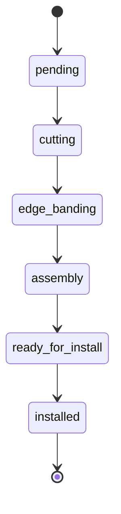

# Cabinet Production Tracker


A small REST API that tracks cabinet orders from the first cut to installation.
An order has several jobs, and every job moves through cutting, edge banding,
assembly and installation. Installers see only their own jobs and may only
change their status.

The focus is database design, access control and code quality rather than the
number of features. Everything runs in containers, so no PHP or PostgreSQL is
needed on the host.

**Stack:** PHP 8.4, Laravel 13, PostgreSQL 17, Laravel Sanctum, PHPUnit, Pint, Larastan.

## Quick start

Requirements: Docker with Compose.

```bash
git clone https://github.com/ahmadjamshidi19/cabinet-production-tracker.git
cd cabinet-production-tracker
docker compose up --build
```

The entrypoint creates `.env` from `.env.example`, installs Composer
dependencies, generates the application key, waits for PostgreSQL, runs the
migrations and seeds the demo data. Once the log shows `Server running`, the
API is available at `http://localhost:8000` (health check: `GET /up`).

Restarting is safe because the seeder does nothing when the demo data already
exists. To reset the data:

```bash
docker compose exec app php artisan migrate:fresh --seed
```

## Demo users

The database is seeded with fake data. Every demo account uses the password
`password`.

| Role      | Email                  |
|-----------|------------------------|
| admin     | admin@example.com      |
| planner   | planner@example.com    |
| installer | installer1@example.com |
| installer | installer2@example.com |

The seed contains 5 orders and 9 jobs that cover every status. Jobs are split
between the two installers, and two jobs are not assigned yet.

## API

All endpoints are under `/api`. Authentication uses Sanctum bearer tokens.
Exchange an email and password for a token, then send it as
`Authorization: Bearer <token>`.

| Method | Path                       | Purpose                                              | Allowed roles                   |
|--------|----------------------------|------------------------------------------------------|---------------------------------|
| POST   | `/api/tokens`              | Exchange email and password for a token              | public                          |
| GET    | `/api/user`                | Current user                                         | any                             |
| POST   | `/api/orders`              | Create an order                                      | admin, planner                  |
| GET    | `/api/orders`              | List orders (paginated)                              | admin, planner                  |
| POST   | `/api/orders/{order}/jobs` | Create a job in an order                             | admin, planner                  |
| GET    | `/api/orders/{order}/jobs` | List the jobs of an order (`status`, `per_page`)     | admin, planner                  |
| GET    | `/api/jobs`                | List jobs (`status`, `per_page`)                     | any; installers see only their own |
| PATCH  | `/api/jobs/{job}/status`   | Change the status of a job                           | see the role matrix below       |

Lists are paginated: `per_page` is between 1 and 100 (default 15) and the
response contains `data`, `links` and `meta`. The `status` filter accepts only
known statuses.

### Errors

Every error under `/api` is JSON, even without an `Accept` header.

| Code | When                                                   | Body                                            |
|------|--------------------------------------------------------|-------------------------------------------------|
| 401  | Missing or invalid token, wrong credentials            | `{"message": "Unauthenticated."}`               |
| 403  | The role may not perform the action                    | `{"message": "This action is unauthorized."}`   |
| 404  | Unknown resource, or a job assigned to someone else    | `{"message": "Resource not found."}`            |
| 422  | Validation failure or an invalid status transition     | `{"message": "...", "errors": {"field": ["..."]}}` |

### Examples

```bash
BASE=http://localhost:8000/api

login() {
  curl -s -X POST "$BASE/tokens" -H 'Content-Type: application/json' \
    -d "{\"email\":\"$1\",\"password\":\"password\"}" | sed -E 's/.*"token":"([^"]+)".*/\1/'
}

PLANNER=$(login planner@example.com)
INSTALLER=$(login installer1@example.com)

# Create an order as a planner: 201, status "pending"
curl -s -X POST "$BASE/orders" -H "Authorization: Bearer $PLANNER" \
  -H 'Content-Type: application/json' \
  -d '{"customer_name":"Test Customer","address":"1 Test Road"}'

# Add a job to order 1 and assign it to installer2 (user id 4): 201, status "pending"
curl -s -X POST "$BASE/orders/1/jobs" -H "Authorization: Bearer $PLANNER" \
  -H 'Content-Type: application/json' \
  -d '{"title":"Extra cabinet","installer_id":4}'

# List jobs with a filter and a page size (an installer sees only their own)
curl -s "$BASE/jobs?status=cutting&per_page=5" -H "Authorization: Bearer $INSTALLER"

# Installer completes their own job at the install step: 200
curl -s -X PATCH "$BASE/jobs/2/status" -H "Authorization: Bearer $INSTALLER" \
  -H 'Content-Type: application/json' -d '{"status":"installed"}'

# Installer tries a production step on their own job: 403
curl -s -o /dev/null -w '%{http_code}\n' -X PATCH "$BASE/jobs/5/status" \
  -H "Authorization: Bearer $INSTALLER" -H 'Content-Type: application/json' \
  -d '{"status":"edge_banding"}'

# Installer asks for another installer's job: 404
curl -s -o /dev/null -w '%{http_code}\n' -X PATCH "$BASE/jobs/3/status" \
  -H "Authorization: Bearer $INSTALLER" -H 'Content-Type: application/json' \
  -d '{"status":"installed"}'

# Planner tries to move a job backwards: 422
curl -s -X PATCH "$BASE/jobs/5/status" -H "Authorization: Bearer $PLANNER" \
  -H 'Content-Type: application/json' -d '{"status":"pending"}'
```

## Design

The full design, written before the implementation, is in
[docs/design.md](docs/design.md). The essentials are below.

### Job status machine



The flow is strictly linear and forward-only. Skipping a step, moving backwards
and moving to the current status are all rejected with `422`.

### Roles and access

| Transition                         | admin | planner | installer               |
|------------------------------------|:-----:|:-------:|:-----------------------:|
| `pending` → `cutting`              | yes   | yes     | no (403)                |
| `cutting` → `edge_banding`         | yes   | yes     | no (403)                |
| `edge_banding` → `assembly`        | yes   | yes     | no (403)                |
| `assembly` → `ready_for_install`   | yes   | yes     | no (403)                |
| `ready_for_install` → `installed`  | yes   | yes     | own jobs only           |

| Action               | admin | planner | installer                        |
|----------------------|:-----:|:-------:|:--------------------------------:|
| Create order or job  | yes   | yes     | no (403)                         |
| List or view orders  | yes   | yes     | no (403)                         |
| List jobs            | all   | all     | only their own                   |
| Another installer's job | visible | visible | 404                          |

A status change is checked in this order: token (401), job lookup through the
visibility scope (404), request body (422), role and ownership policy (403),
transition validity inside the transaction (422). Authorization comes before
transition validity on purpose: a caller who may not perform a step learns
nothing about the state machine, and forbidden requests never wait for a lock.

### Data model

| Table                  | Notes                                                                  |
|------------------------|------------------------------------------------------------------------|
| `users`                | `role` (`admin`, `planner`, `installer`) with a CHECK constraint       |
| `orders`               | customer, address, `created_by`; no status column (see decisions)      |
| `production_jobs`      | `order_id`, nullable `installer_id`, `title`, `status` with a CHECK    |
| `job_status_histories` | append-only: `job_id`, `changed_by`, `from_status`, `to_status`, `created_at` |

The ER diagram is in [docs/design.md](docs/design.md). Foreign keys declare
their `ON DELETE` behaviour explicitly, and PostgreSQL does not index foreign
key columns by itself, so the indexes are created by hand:

| Index                                       | Reason                                               |
|---------------------------------------------|------------------------------------------------------|
| `production_jobs (order_id)`                | Load the jobs of an order                            |
| `production_jobs (installer_id, status)`    | An installer's job list, optionally filtered         |
| `production_jobs (status)`                  | Status filter for planners and admins                |
| `job_status_histories (job_id, created_at)` | Read the history of one job in order                 |
| `orders (created_by)`                       | Foreign key lookup                                   |

### Key decisions

| Decision | Why |
|----------|-----|
| Order status is derived from its jobs and never stored. No jobs or all `pending` gives `pending`, all `installed` gives `installed`, anything else gives `in_progress`. | A stored value can drift from the jobs. Deriving it keeps one source of truth. Lists eager load only the three job columns needed, so there is no N+1. |
| Transition rules live in the `JobStatus` enum (`allowedTransitions()`, `canTransitionTo()`). | One place to read and change them, no scattered `if` statements, and the enum is a plain class that is easy to unit test. |
| `TransitionJobStatus` runs in a transaction and locks the job row with `lockForUpdate()`. | Two concurrent requests could both validate against the same status and write two history rows that do not form a chain. With the lock the second request waits and validates again against the new status. The status change and its history row commit together. |
| A job of another installer returns 404, not 403. Order endpoints return 403 for installers. | A 403 confirms that the job exists. Jobs are hidden resources, orders are not. Hiding is done by one `visibleTo` query scope plus a scoped route binding, so it cannot be forgotten in a controller. |
| Invalid transitions and invalid filters return 422. | The request is well formed but cannot be applied. The error body has the same shape as a validation error, so clients handle one format. |
| The table is called `production_jobs`. | Laravel's database queue already owns a table called `jobs`. |
| The database guards its own rules: CHECK constraints on status and role, foreign keys, and no `updated_at` on the history table. | Invalid data is rejected even if it bypasses PHP validation. |
| The actor in the history comes from the authenticated user. `role`, `status` and `created_by` are not mass assignable, and a `status` sent when creating a job is ignored. | A request body can never claim who made a change, set a role or skip the state machine. `installer_id` must reference a user whose role is `installer`. |
| Sanctum bearer tokens, with every `/api` error rendered as JSON. | Simple and enough for an API without a login page. Without the JSON rule, an unauthenticated request lacking an `Accept` header would be redirected to a login route that does not exist. |
| Tests run against real PostgreSQL, in a separate `app_testing` database. | CHECK constraints and row locks behave differently on SQLite. |
