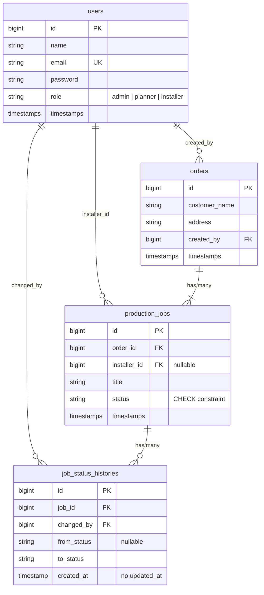

# Design Document

This document defines the domain model, state machine, access rules and
database schema of the Cabinet Production Tracker API. It is written before
the implementation so that every later change can be traced back to a decision.

## 1. Scope

An order for cabinets contains several jobs. Each job passes through cutting,
edge banding, assembly and installation. Installers see only their own jobs
and may only change the status of those jobs.

Out of scope: frontend, login page, file upload, user management.

## 2. Job Statuses

```
pending -> cutting -> edge_banding -> assembly -> ready_for_install -> installed
```

| Status              | Meaning                                            |
|---------------------|----------------------------------------------------|
| `pending`           | Job is created and waiting for production          |
| `cutting`           | Panels are being cut                               |
| `edge_banding`      | Edges are being banded                             |
| `assembly`          | Cabinet is being assembled                         |
| `ready_for_install` | Assembled, waiting for the installer               |
| `installed`         | Installed at the customer address (terminal state) |

### 2.1 Allowed transitions

The flow is strictly linear and forward-only. There is no backward transition.

| From                | To                  |
|---------------------|---------------------|
| `pending`           | `cutting`           |
| `cutting`           | `edge_banding`      |
| `edge_banding`      | `assembly`          |
| `assembly`          | `ready_for_install` |
| `ready_for_install` | `installed`         |
| `installed`         | (none)              |

Rules:

- Skipping a step is not allowed (`pending` -> `assembly` is rejected).
- Moving backwards is not allowed (`installed` -> `cutting` is rejected).
- Transition to the current status is rejected as invalid.
- All rules live in one place: the `JobStatus` enum
  (`allowedTransitions()` and `canTransitionTo()`).

## 3. Roles and Access

Roles: `admin`, `planner`, `installer`.

### 3.1 Role x transition matrix

| Transition                              | admin | planner | installer     |
|-----------------------------------------|:-----:|:-------:|:-------------:|
| `pending` -> `cutting`                  |  yes  |   yes   |      no       |
| `cutting` -> `edge_banding`             |  yes  |   yes   |      no       |
| `edge_banding` -> `assembly`            |  yes  |   yes   |      no       |
| `assembly` -> `ready_for_install`       |  yes  |   yes   |      no       |
| `ready_for_install` -> `installed`      |  yes  |   yes   | yes (own jobs)|

### 3.2 Role x action matrix

| Action                       | admin | planner | installer      |
|------------------------------|:-----:|:-------:|:--------------:|
| Create order                 |  yes  |   yes   |       no       |
| Create job                   |  yes  |   yes   |       no       |
| List / view orders           |  yes  |   yes   |       no       |
| List / view jobs             |  all  |   all   | only own jobs  |
| Change job status            |  yes  |   yes   | own jobs, install step only |

### 3.3 Response codes for access failures

| Situation                                        | Code |
|--------------------------------------------------|------|
| Missing or invalid token                         | 401  |
| Installer requests a job assigned to someone else| 404  |
| Installer tries a production-stage transition on own job | 403 |
| Installer tries to create an order or a job      | 403  |
| Invalid status transition                        | 422  |
| Invalid `status` filter value                    | 422  |

Why 404 instead of 403 for other people's jobs: a 403 confirms that the
resource exists. A 404 reveals nothing about jobs the caller must not see.

## 4. Data Model



### 4.1 Table notes

- **`production_jobs`** is named this way on purpose. Laravel's database queue
  uses a table called `jobs`, so reusing that name would cause a collision.
- **Status columns** (`production_jobs.status`, history `from_status` and
  `to_status`) and `users.role` get a database `CHECK` constraint, so invalid
  values are rejected even if they bypass PHP validation.
- **`job_status_histories`** is append-only: no `updated_at`, and the
  application never updates or deletes rows.
- **`from_status` is nullable** to allow recording the initial creation of a
  job (no previous status).
- **`orders.status` is not stored** (see decision D1).

### 4.2 Foreign keys

| Column                                | References | On delete  |
|---------------------------------------|------------|------------|
| `orders.created_by`                   | `users`    | restrict   |
| `production_jobs.order_id`            | `orders`   | cascade    |
| `production_jobs.installer_id`        | `users`    | set null   |
| `job_status_histories.job_id`         | `production_jobs` | cascade |
| `job_status_histories.changed_by`     | `users`    | restrict   |

### 4.3 Indexes

PostgreSQL does not create indexes on foreign key columns automatically.

| Index                                         | Reason                                                   |
|-----------------------------------------------|----------------------------------------------------------|
| `production_jobs (order_id)`                  | Load the jobs of an order                                |
| `production_jobs (installer_id, status)`      | Installer's job list, optionally filtered by status      |
| `production_jobs (status)`                    | Filter by status and the jobs-per-status report          |
| `job_status_histories (job_id, created_at)`   | Read the history of one job in chronological order       |
| `orders (created_by)`                         | Foreign key lookup                                       |

## 5. Decisions

| #  | Decision | Reason |
|----|----------|--------|
| D1 | Order status is derived from its jobs, not stored | A stored value can drift out of sync with the jobs. Deriving it keeps a single source of truth. |
| D2 | 404 for other installers' jobs | Does not reveal that the job exists. |
| D3 | 422 for invalid transitions and invalid filters | The request is well-formed but semantically invalid. |
| D4 | 403 for a valid job the role may not transition | The caller can see the job but lacks permission for that step. |
| D5 | Table name `production_jobs` | Avoids collision with Laravel's queue table `jobs`. |
| D6 | Transition rules live in the `JobStatus` enum | One source of truth, no scattered `if` statements. |
| D7 | Status change runs in a DB transaction with `lockForUpdate()` | Two concurrent requests must not produce an inconsistent history. |
| D8 | Actor in history comes from the authenticated user, never the request body | Prevents spoofing "who changed it". |
| D9 | Installer visibility is a query scope (`visibleTo`) | Applied in one place so it cannot be forgotten. |
| D10 | Authentication with Laravel Sanctum tokens | Simple and sufficient for an API without a login UI. |
| D11 | Tests run against real PostgreSQL | `CHECK` constraints and row locks behave differently on SQLite. |

### 5.1 Derived order status

An order's status is computed from its jobs:

| Condition                                  | Order status  |
|--------------------------------------------|---------------|
| No jobs, or all jobs `pending`             | `pending`     |
| All jobs `installed`                       | `installed`   |
| Anything else                              | `in_progress` |

### 5.2 Status transition endpoint

`PATCH /api/jobs/{job}/status` with body `{ "status": "assembly" }`.

Steps (all inside one transaction):

1. Resolve the job through the `visibleTo` scope (other installers get 404).
2. Lock the job row with `lockForUpdate()`.
3. Check that the transition is allowed by the enum (otherwise 422).
4. Check that the actor's role may perform it (otherwise 403).
5. Update the status and insert a history row.

## 6. API Overview

| Method | Path                         | Purpose                               |
|--------|------------------------------|---------------------------------------|
| POST   | `/api/tokens`                | Exchange email and password for token |
| POST   | `/api/orders`                | Create an order                       |
| GET    | `/api/orders`                | List orders (paginated)               |
| POST   | `/api/orders/{order}/jobs`   | Create a job in an order              |
| GET    | `/api/orders/{order}/jobs`   | List jobs of an order                 |
| GET    | `/api/jobs`                  | List jobs (`?status=`, `?per_page=`)  |
| PATCH  | `/api/jobs/{job}/status`     | Change job status                     |
